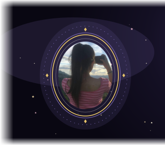
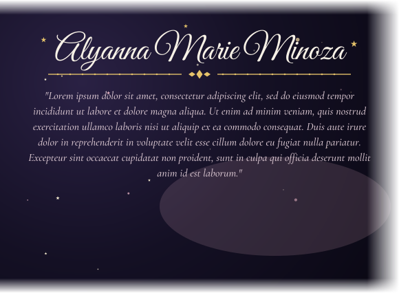

<!--
The pictures are built from the files in content/.

name and the lines under the name: content/profile.json
  name and bio. They are drawn into assets/profile/header-words.svg only.
account links under the portrait: content/profile.json, the links list
  label is the words beside the icon. url is where a click goes.
  Type the account there. The icon files in assets/profile/icons stay as they are.
  Facebook, GitHub, and LinkedIn are separate pictures, so a click opens url
  instead of opening the picture file.
one project per object, in order: content/projects.json
  image is a planet file already in assets/, or a new one
  imageSide is "left" or "right"
  badge is "PRIVATE" or ""
  description, detail, and tags are the words on the card
stack icons: drop an .svg or .png into assets/stacks, then rebuild.
  name them 01-something.svg, 02-something.svg to set the order
quotes, one per line: content/quotes.txt
  a credit after an em dash is kept in the file and left off the picture
usernames: content/stats.json
  github_username is already set
  leetcode_username and duolingo_username stay empty until you fill them
  with no Duolingo username, the lower number counts up by one each day

Pushing a change in content/ redraws the pictures on GitHub.
The picture address changes with the words, so the page does not keep the old drawing.
-->

<table cellspacing="0" cellpadding="0">
<tr>
<td width="37%" align="center" valign="top">

 
 

</td>
<td width="63%" valign="top">

</td>
</tr>
</table>

 

  

  

  

  

  

  

<table>
<tr>
<td width="58%" valign="top">

</td>
<td width="42%" valign="top">

</td>
</tr>
</table>
