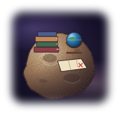

<!--
Front cover later: Alyanna Marie Miñoza, and the short landing sentence.
Brackets are yours to replace. Each picture sits beside the lines for that world.
Peak Hunter and Jeepney Router have no links while they are private.
The sky is rebuilt by lab/build_scene.py.
-->

# Worlds from one sky.

[One or two sentences you write. The visitor has just landed.]

## Planets

<table>
<tr>
<td width="88"></td>
<td valign="top" width="50%">

**The ringed world**

[A future project. Your sentences, when you have them.]

[More about this world, if you want it.]

✰ `[tag]` · ✰ `[tag]` · ✰ `[tag]`

</td>
<td width="88"></td>
<td valign="top">

**The lantern world**

[A future project. Your sentences, when you have them.]

[More about this world, if you want it.]

✰ `[tag]` · ✰ `[tag]` · ✰ `[tag]`

</td>
</tr>
<tr>
<td width="88"></td>
<td valign="top">

**Peak Hunter** · private

[A short description, in your words.]

Still exploring. No public link yet.

✰ `[tag]` · ✰ `[tag]` · ✰ `[tag]`

</td>
<td width="88"></td>
<td valign="top">

**The books world**

[A future project. Your sentences, when you have them.]

[More about this world, if you want it.]

✰ `[tag]` · ✰ `[tag]` · ✰ `[tag]`

</td>
</tr>
<tr>
<td width="88"></td>
<td valign="top">

**Jeepney Router** · private

[A short description, in your words.]

Still exploring. No public link yet.

✰ `[tag]` · ✰ `[tag]` · ✰ `[tag]`

</td>
<td width="88"></td>
<td valign="top">

**The sprout world**

[A future project. Your sentences, when you have them.]

[More about this world, if you want it.]

✰ `[tag]` · ✰ `[tag]` · ✰ `[tag]`

</td>
</tr>
</table>

## Stars

<table>
<tr>
<td width="280"></td>
<td valign="top">

**Constellation**

[What this field of stars is for, in your words.]

Languages, tools, skills, certificates, and surprises, mixed together.

</td>
</tr>
</table>

<table>
<tr>
<td width="36"></td>
<td valign="top" width="50%">

**[symbol]** · tool

[What appears when it opens.]

</td>
<td width="36"></td>
<td valign="top">

**[symbol]** · certificate

[Issuer, year if you want it public, one sentence.]

</td>
</tr>
<tr>
<td></td>
<td valign="top">

**[symbol]** · language

[What appears when it opens.]

</td>
<td></td>
<td valign="top">

**[symbol]** · surprise

[A hidden note.]

</td>
</tr>
<tr>
<td></td>
<td valign="top">

**[symbol]** · skill

[What appears when it opens.]

</td>
<td></td>
<td valign="top">

**[symbol]** · framework

[What appears when it opens.]

</td>
</tr>
<tr>
<td></td>
<td valign="top">

**[symbol]** · language

[What appears when it opens.]

</td>
<td></td>
<td valign="top">

**[symbol]** · tool

[What appears when it opens.]

</td>
</tr>
</table>

## Close to the asteroid

<table>
<tr>
<td width="88"></td>
<td valign="top" width="50%">

**[What you care for]**

[Your sentences. This sits apart from the planets.]

</td>
<td width="88"></td>
<td valign="top">

**[A quote, a joke, or a hidden note]**

[Your words.]

</td>
</tr>
<tr>
<td width="200"></td>
<td valign="top" colspan="3">

**[What you are learning]**

[Your sentences.]

[The next thing on the path.]

✰ `[tag]` · ✰ `[tag]` · ✰ `[tag]`

</td>
</tr>
</table>

Original composed scene

