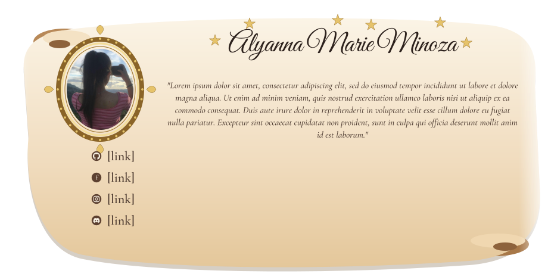
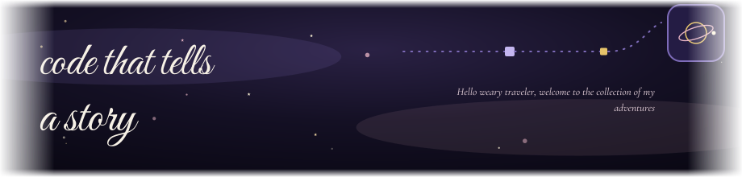
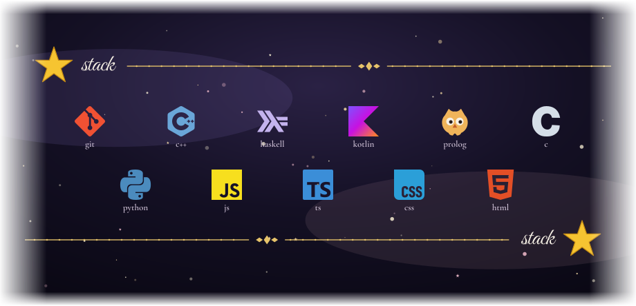
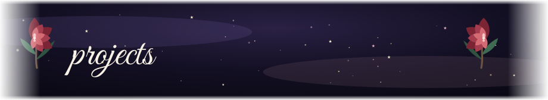
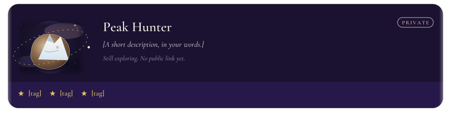
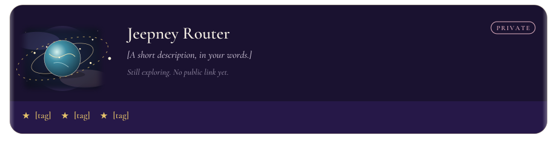

<!--
The pictures are built from the files in content/.

name, scroll text, welcome line, and the four [link] labels under the portrait: content/profile.json
one project per object, in order: content/projects.json
  image is a planet file already in assets/, or a new one
  imageSide is "left" or "right"
  badge is "PRIVATE" or ""
  description, detail, and tags are the words on the card
stack icons: drop an .svg or .png into assets/stacks, then rebuild.
  name them 01-something.svg, 02-something.svg to set the order
quotes, one per line: content/quotes.txt
  a credit after an em dash is kept in the file and left off the picture
usernames: content/stats.json
  github_username is already set
  leetcode_username and duolingo_username stay empty until you fill them
  with no Duolingo username, the lower number counts up by one each day

Pushing a change in content/ redraws the pictures on GitHub.
The picture address changes with the words, so the page does not keep the old drawing.
-->

  

 

  

  

  

  

  

  

<table>
<tr>
<td width="58%" valign="top">

</td>
<td width="42%" valign="top">

</td>
</tr>
</table>
