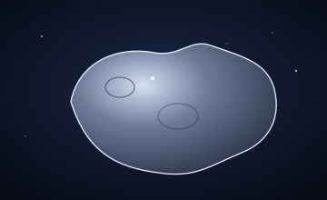
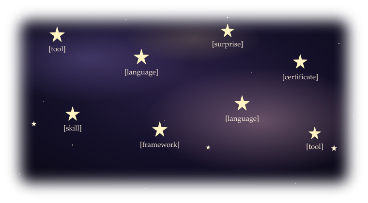
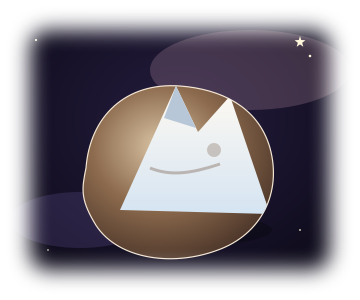
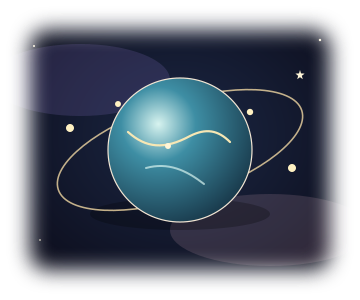
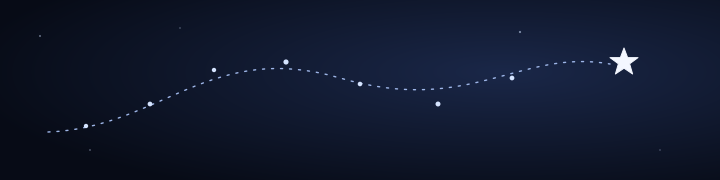
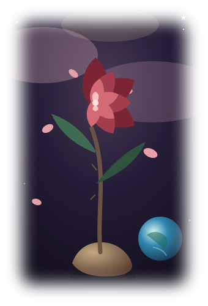
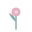
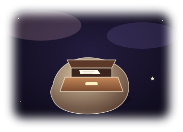
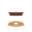

<!--
Placeholders in brackets are yours to replace, leave blank, or mark "as I wrote it."
Stars can be added, removed, renamed, or reshuffled.
Peak Hunter and Jeepney Router have no links while they are private.
-->

# [Your name]

### a small asteroid

[One or two sentences you write. The visitor has just landed.]

## The sky — stars

Languages, tools, skills, certificates, and surprises, mixed together. Each star shows a symbol placeholder for now. Open a star to read the detail. Their places are shuffled, not grouped.

 [symbol] [Tool]

[What appears when it opens.]

 [symbol] [Certificate]

[Issuer, year if you want it public, one sentence.]

 [symbol] [Language]

[What appears when it opens.]

 [symbol] [Surprise]

[A hidden note.]

 [symbol] [Skill]

[What appears when it opens.]

 [symbol] [Framework]

[What appears when it opens.]

 [symbol] [Language]

[What appears when it opens.]

 [symbol] [Tool]

[What appears when it opens.]

## The sky — planets

One planet is one project. Open it to read the adventure. When there are many projects, a planet can become a category and the projects can sit inside it.

 Peak Hunter

[A short description, in your words.]

Still exploring. No public link yet.

 Jeepney Router

[A short description, in your words.]

Still exploring. No public link yet.

## Where you are headed

 [What you are learning]

[Your sentences.]

## The rose

 [What you care for]

[Your sentences. This sits apart from the planets.]

## A small drawer

 [A quote, a joke, or a hidden note]

[Your words.]

